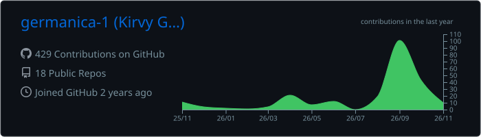
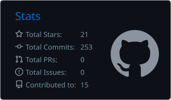
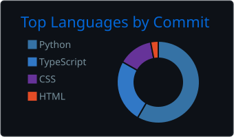

<h1 align="center">Hi, I'm Kirvy (@germanica-1).</h1>

<h3 align="center">About Me</h3>

- 🔭 I’m currently working on [PAWI](https://www.pawii.me/)  
   

- 👀 I’m interested in **programming and exploring different ways to maximize workflow.**  
   

- 🌱 I’m still studying and learning **TypeScript, React, TailwindCSS, Supabase, Python (FastAPI, Flask), and computer vision with OpenCV and MediaPipe, while strengthening my skills with projects I've been doing as a student and freelancing.**  
   

- 📫 How to reach me: **Contact me through my email: kirvyatbusiness2@gmail.com**  
   

<h3 align="left">Languages and Tools:</h3>

<table>
  <tr>
    <td align="center" width="80">
      
       TypeScript
    </td>
    <td align="center" width="80">
      
       JavaScript
    </td>
    <td align="center" width="80">
      
       Python
    </td>
    <td align="center" width="80">
      
       Java
    </td>
    <td align="center" width="80">
      
       HTML5
    </td>
    <td align="center" width="80">
      
       CSS3
    </td>
  </tr>
  <tr>
    <td align="center" width="80">
      
       React
    </td>
    <td align="center" width="80">
      
       Vite
    </td>
    <td align="center" width="80">
      
       Tailwind
    </td>
    <td align="center" width="80">
      
       FastAPI
    </td>
    <td align="center" width="80">
      
       Flask
    </td>
    <td align="center" width="80">
      
       PyQt
    </td>
  </tr>
  <tr>
    <td align="center" width="80">
      
       Supabase
    </td>
    <td align="center" width="80">
      
       MySQL
    </td>
    <td align="center" width="80">
      
       SQLite
    </td>
    <td align="center" width="80">
      
       Firebase
    </td>
    <td align="center" width="80">
      
       OpenCV
    </td>
    <td align="center" width="80">
      
       Pygame
    </td>
  </tr>
  <tr>
    <td align="center" width="80">
      
       Git
    </td>
    <td align="center" width="80">
      
       Figma
    </td>
    <td align="center" width="80">
      
       Vercel
    </td>
  </tr>
</table>

<h3 align="left">Github Stats:</h3>

  

  
  

  

